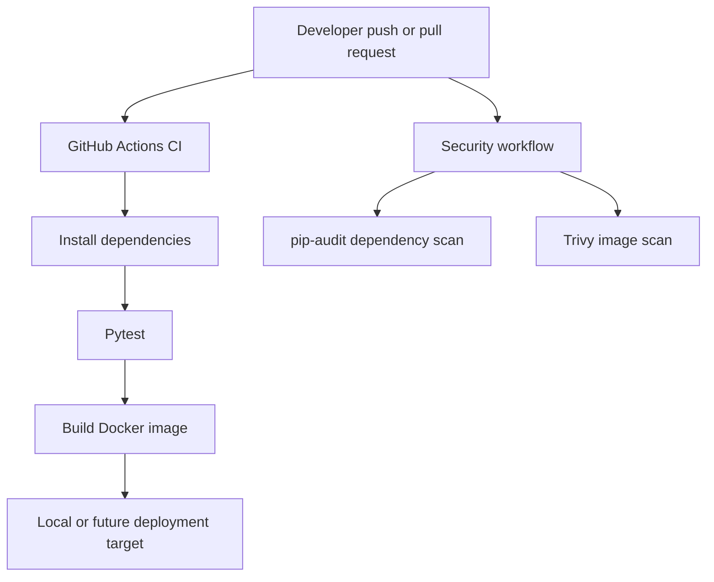

# Architecture

This starter intentionally separates CI and security checks from deployment. Add a deployment job only after choosing and documenting a safe target-specific authentication and runner design. For a public repository, do not run untrusted pull-request code on a privileged self-hosted runner.
